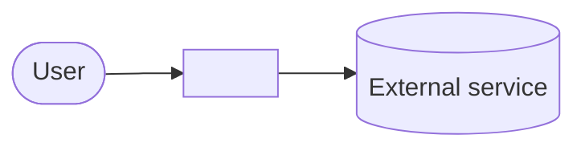
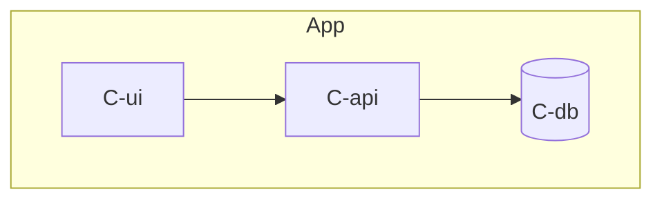
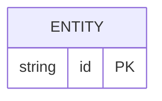
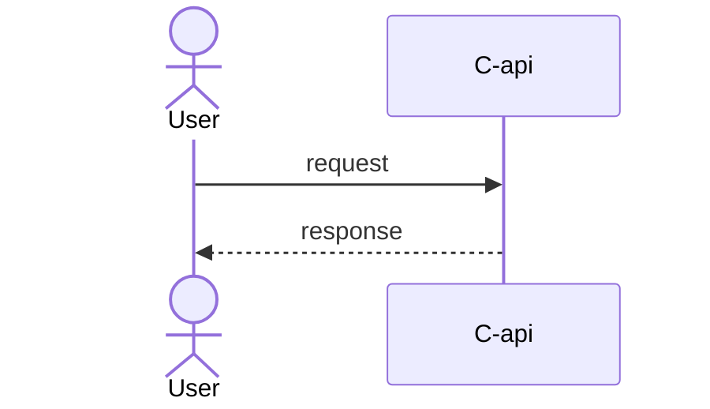

# Architecture

## System context

## Components
| ID      | Responsibility | Tech | Serves |
| ------- | -------------- | ---- | ------ |
| C-api   |                |      | FR-001 |

## Data model

## Key flows

## Cross-cutting concerns
- **AuthN/AuthZ:** 
- **Error handling & logging:** 
- **Configuration & secrets:** 
- **Testing strategy:** 
- **Deployment:** 

## Decisions
<!-- Link ADRs: ADR-0001 ... -->
