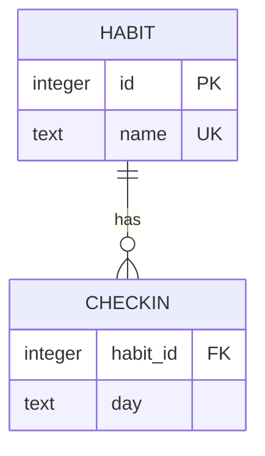

# Chat export: Streak (sample)

> This is a condensed, hand-written example of what a Stage 8 export looks like
> after running the prompt pack. Conversation text outside the file markers is
> ignored by `its import`.

**User:** Stage 8. Run the consistency check and export everything.

**Assistant:** Consistency check: all IDs defined once, every Must FR is covered by a task, no drafts left in vision/features/requirements. Architecture, design and plan are approved too. Exporting now.

<!-- file: package.yaml -->
```yaml
spec_version: "0.1"

project:
  name: "Streak"
  slug: "streak"
  summary: "A tiny command-line habit tracker that shows your current streak for each habit."
  license: "MIT"

stack:
  language: "python"
  runtime: "3.12"
  framework: "none (stdlib argparse + sqlite3)"
  package_manager: "uv"
  test: "pytest"
  lint: "ruff"

agents: [codex, claude, copilot, cursor]

commands:
  setup: "uv sync"
  test: "uv run pytest"
  lint: "uv run ruff check ."
  run: "uv run python -m streak --help"

artifacts:
  planning/00-idea.md: approved
  planning/01-vision.md: approved
  planning/02-features.md: approved
  planning/03-requirements.md: approved
  planning/04-architecture.md: approved
  planning/05-design.md: approved
  planning/06-project-plan.md: approved

first_task: "T-1.1"
```
<!-- end file -->

<!-- file: AGENTS.md -->
````markdown
# AGENTS.md — Streak

> Canonical instructions for every coding agent (Codex, Claude Code, Copilot, Cursor).
> Tool-specific files point here. Edit this file, not them.

## Project
Streak is a single-user command-line habit tracker. You add habits, check them off each day, and it shows your current and best streak. It stores data locally in SQLite and has no network access.

## Source of truth
Planning docs live in `docs/planning/`. Read them in this order before starting work:

1. `01-vision.md` — goals (G-n) and non-goals
2. `02-features.md` — features (F-nn)
3. `03-requirements.md` — requirements (FR-nnn, NFR-nnn) and acceptance criteria
4. `04-architecture.md` — components (C-name), data model, flows
5. `05-design.md` — CLI surface and output formats
6. `06-project-plan.md` — milestones (Mn) and tasks (T-n.m)
7. `adr/` — decisions already made

Docs with `status: approved` are binding. If the code needs to diverge from an approved doc, stop and propose the change (see `docs/playbooks/update-plan.md`) instead of diverging silently.

## Stack & commands
- **Language / runtime:** <language> <runtime>
- **Framework:** <framework>
- **Setup:** `<setup>`
- **Test:** `<test>`
- **Lint:** `<lint>`
- **Run:** `<run>`

Run test and lint before declaring any task done.

## Repository layout
```text
src/streak/     application code (cli.py, store.py, streaks.py)
tests/          pytest tests, one file per module
docs/planning/  planning package (source of truth)
docs/playbooks/ repeatable procedures for agents
```

## How to work
1. Pick the next unblocked task from `06-project-plan.md` (start at the task named in `HANDOFF.md`).
2. Read the requirements it satisfies and their acceptance criteria.
3. Implement in small steps with tests that prove each acceptance criterion.
4. Commit using `<type>(<scope>): <summary> [T-n.m]` with `Refs: FR-xxx` in the body.
5. Tick the task's `- [ ] Done` box in `06-project-plan.md` in the same change.

## Conventions
- Standard library only at runtime. Type hints everywhere; `from __future__ import annotations`.
- Streak maths lives in `streaks.py` as pure functions that take dates; never call `date.today()` inside them.
- User-facing errors go to stderr with exit code 1; no stack traces for expected errors.
- Tests use a temporary database via the `tmp_path` fixture.

## Boundaries
Ask a human before you:
- add a new runtime dependency or service
- change the data schema or the CLI commands and flags
- edit any `approved` planning doc
- touch secrets, credentials, CI deploy steps or licensing

Never commit secrets. Never disable or skip tests to make a build pass.

## Playbooks
- `docs/playbooks/implement-task.md` — take one task from the plan to a reviewed commit
- `docs/playbooks/update-plan.md` — propose a change to the planning docs
- `docs/playbooks/write-adr.md` — record an architecture decision
````
<!-- end file -->

<!-- file: planning/00-idea.md -->
```markdown
---
id: idea
title: Idea
status: approved
version: 1.0
updated: 2026-11-26
depends_on: []
---

# Idea

## The pitch
A habit tracker that lives in the terminal. Type `streak done read` and it tells you you're on day 12.

## Why now / why me
I live in the terminal and every habit app wants an account and a phone.

## Rough shape
- One user, one machine, local SQLite file.
- Commands: add, done, list, remove.

## Open questions
- None remaining.

## Ideation notes
- Considered a TUI dashboard: rejected for v1, too much surface.
- Considered syncing via a Git repo: deferred (Won't for v1).
```
<!-- end file -->

<!-- file: planning/01-vision.md -->
```markdown
---
id: vision
title: Vision
status: approved
version: 1.0
updated: 2026-11-26
depends_on: [idea]
---

# Vision

## Problem
Terminal-heavy developers who want to build habits have to leave the terminal and sign up for an app.

## Target users
| Persona | Description | Primary need |
| ------- | ----------- | ------------ |
| Dev     | Works in a terminal all day | Log a habit in under two seconds |

## Goals
- **G-1** — Logging a habit takes one short command.
- **G-2** — The current streak is visible immediately after logging.

## Non-goals
- Multiple users, sync, reminders, a GUI.

## Success metrics
| Metric | Target | Goal |
| ------ | ------ | ---- |
| Keystrokes to log a habit | ≤ 20 | G-1 |

## Constraints & assumptions
- Python 3.12, standard library only at runtime.
```
<!-- end file -->

<!-- file: planning/02-features.md -->
```markdown
---
id: features
title: Features
status: approved
version: 1.0
updated: 2026-11-26
depends_on: [vision]
---

# Features

| ID   | Feature        | Priority | Supports | Milestone |
| ---- | -------------- | -------- | -------- | --------- |
| F-01 | Manage habits  | Must     | G-1      | M2        |
| F-02 | Check in       | Must     | G-1, G-2 | M2        |
| F-03 | View streaks   | Must     | G-2      | M2        |

---

## F-01 — Manage habits
**Priority:** Must · **Supports:** G-1

**User story:** As a dev, I want to add and remove habits so that I track only what matters.

**Requirements:** FR-001, FR-002
**Screens:** S-cli

## F-02 — Check in
**Priority:** Must · **Supports:** G-1, G-2

**User story:** As a dev, I want to mark a habit done for today so that my streak grows.

**Requirements:** FR-003
**Screens:** S-cli

## F-03 — View streaks
**Priority:** Must · **Supports:** G-2

**User story:** As a dev, I want to see current and best streaks so that I stay motivated.

**Requirements:** FR-004
**Screens:** S-cli
```
<!-- end file -->

<!-- file: planning/03-requirements.md -->
```markdown
---
id: requirements
title: Requirements
status: approved
version: 1.0
updated: 2026-11-26
depends_on: [features]
---

# Requirements

## Functional requirements

### FR-001 — Add a habit
**Feature:** F-01 · **Priority:** Must

**Acceptance criteria**
- **Given** no habit named "read" **when** I run `streak add read` **then** it is stored and the CLI prints `Added read`.
- **Given** a habit "read" exists **when** I run `streak add read` **then** it exits 1 with `read already exists`.

### FR-002 — Remove a habit
**Feature:** F-01 · **Priority:** Must

**Acceptance criteria**
- **Given** "read" exists **when** I run `streak remove read` **then** it and its check-ins are deleted.

### FR-003 — Check in for today
**Feature:** F-02 · **Priority:** Must

**Acceptance criteria**
- **Given** "read" exists **when** I run `streak done read` **then** today is recorded and the current streak is printed.
- **Given** I already checked in today **when** I run it again **then** nothing changes and it says `already done today`.

### FR-004 — Show streaks
**Feature:** F-03 · **Priority:** Must

**Acceptance criteria**
- **Given** check-ins on the last 3 consecutive days including today **when** I run `streak list` **then** "read" shows current 3.
- **Given** no check-in yesterday or today **when** I run `streak list` **then** current is 0 and best is unchanged.

## Non-functional requirements

| ID      | Category    | Requirement | Measure / target |
| ------- | ----------- | ----------- | ---------------- |
| NFR-001 | Performance | Commands respond quickly | < 200 ms with 10k check-ins |
| NFR-002 | Reliability | Data survives crashes | SQLite in WAL mode, writes in transactions |

## Data & privacy
Only habit names and dates are stored, in `~/.local/share/streak/streak.db`. Nothing leaves the machine.
```
<!-- end file -->

<!-- file: planning/04-architecture.md -->
````markdown
---
id: architecture
title: Architecture
status: approved
version: 1.0
updated: 2026-11-26
depends_on: [requirements]
---

# Architecture

## System context


## Components
| ID          | Responsibility                  | Tech     | Serves |
| ----------- | ------------------------------- | -------- | ------ |
| C-cli       | Parse commands, format output   | argparse | FR-001, FR-002, FR-003, FR-004 |
| C-store     | Persist habits and check-ins    | sqlite3  | FR-001, FR-002, FR-003, NFR-002 |
| C-streaks   | Compute current and best streak | pure Python | FR-004, NFR-001 |

## Data model


## Cross-cutting concerns
- **Error handling:** expected errors raise `StreakError`; C-cli prints them to stderr and exits 1.
- **Testing strategy:** unit tests for C-streaks with fixed dates; CLI tests against a temp database.

## Decisions
- ADR-0001 — Record architecture decisions
- ADR-0002 — SQLite over JSON file
````
<!-- end file -->

<!-- file: planning/05-design.md -->
```markdown
---
id: design
title: Design
status: approved
version: 1.0
updated: 2026-11-26
depends_on: [features, architecture]
---

# Design

No GUI. The only "screen" is the CLI surface.

## Screens & navigation
| ID    | Screen       | Purpose | Requirements |
| ----- | ------------ | ------- | ------------ |
| S-cli | Command line | All interaction | FR-001, FR-002, FR-003, FR-004 |

## CLI surface
| Command | Output |
| ------- | ------ |
| `streak add <name>` | `Added <name>` |
| `streak remove <name>` | `Removed <name>` |
| `streak done <name>` | `<name>: day <n> 🔥` |
| `streak list` | table: name, current, best |
```
<!-- end file -->

<!-- file: planning/06-project-plan.md -->
```markdown
---
id: project-plan
title: Project Plan
status: approved
version: 1.0
updated: 2026-11-26
depends_on: [requirements, architecture, design]
---

# Project Plan

## Milestones
| ID | Name | Outcome | Features |
| -- | ---- | ------- | -------- |
| M1 | Walking skeleton | `streak --help` runs, CI green | — |
| M2 | Core habits | Add, done, list, remove all work | F-01, F-02, F-03 |

## Tasks

### M1 — Walking skeleton

#### T-1.1 — Project setup verified
**Satisfies:** NFR-002 · **Depends on:** —
- **Do:** Run setup, test and lint on the fresh scaffold; add `src/streak/__main__.py` with an argparse stub so `python -m streak --help` works.
- **Done when:** CI passes and `uv run python -m streak --help` prints usage.
- [ ] Done

### M2 — Core habits

#### T-2.1 — Store
**Satisfies:** FR-001, FR-002, NFR-002 · **Depends on:** T-1.1
- **Do:** Implement C-store with the schema from the architecture doc.
- **Done when:** add/remove tests pass against a temp database.
- [ ] Done

#### T-2.2 — Streak maths
**Satisfies:** FR-004, NFR-001 · **Depends on:** T-1.1
- **Do:** Implement C-streaks as pure functions.
- **Done when:** tests cover consecutive, broken and empty histories.
- [ ] Done

#### T-2.3 — CLI commands
**Satisfies:** FR-001, FR-002, FR-003, FR-004 · **Depends on:** T-2.1, T-2.2
- **Do:** Wire C-cli commands to C-store and C-streaks.
- **Done when:** every acceptance criterion has a passing CLI test.
- [ ] Done
```
<!-- end file -->

<!-- file: planning/adr/ADR-0002-sqlite-over-json.md -->
```markdown
---
id: ADR-0002
title: SQLite over JSON file
status: approved
version: 1.0
updated: 2026-11-26
depends_on: []
---

# ADR-0002 — SQLite over JSON file

**Status:** Accepted

## Context
NFR-002 needs crash safety; NFR-001 needs fast queries over years of check-ins.

## Options considered
- **JSON file:** simplest, but partial writes can corrupt it.
- **SQLite:** in the standard library, transactional, fast.

## Decision
Use SQLite via `sqlite3`.

## Consequences
Schema changes need a small migration step.
```
<!-- end file -->

That's the full package. Save this chat and run `its import`.
