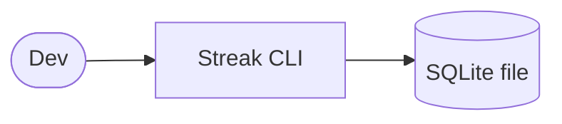
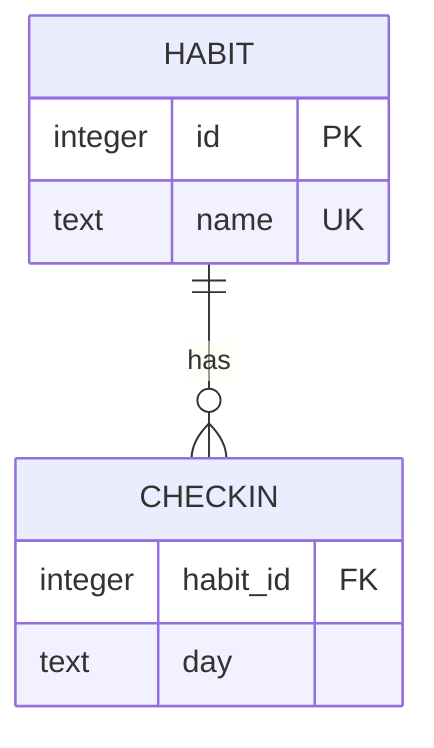

# Chat export: Streak (sample)

> This is a condensed, hand-written example of what a Stage 8 export looks like
> after running the prompt pack. Conversation text outside the file markers is
> ignored by `its import`.

**User:** Stage 8. Run the consistency check and export everything.

**Assistant:** Consistency check: all IDs defined once, every Must FR is covered by a task, no drafts left in vision/features/requirements. Architecture, design and plan are approved too. Exporting now.

<!-- file: package.yaml -->
```yaml
spec_version: "0.1"

project:
  name: "Streak"
  slug: "streak"
  summary: "A tiny command-line habit tracker that shows your current streak for each habit."
  license: "MIT"

stack:
  language: "python"
  runtime: "3.12"
  framework: "none (stdlib argparse + sqlite3)"
  package_manager: "uv"
  test: "pytest"
  lint: "ruff"

agents: [codex, claude, copilot, cursor]

commands:
  setup: "uv sync"
  test: "uv run pytest"
  lint: "uv run ruff check ."
  run: "uv run python -m streak --help"

artifacts:
  planning/00-idea.md: approved
  planning/01-vision.md: approved
  planning/02-features.md: approved
  planning/03-requirements.md: approved
  planning/04-architecture.md: approved
  planning/05-design.md: approved
  planning/06-project-plan.md: approved
  planning/07-backlog.md: approved

```
<!-- end file -->

<!-- file: AGENTS.md -->
````markdown
# AGENTS.md — Streak

> Canonical instructions for every coding agent (Codex, Claude Code, Copilot, Cursor).
> Tool-specific files point here. Edit this file, not them.

## Project
Streak is a single-user command-line habit tracker. You add habits, check them off each day, and it shows your current and best streak. It stores data locally in SQLite and has no network access.

## Source of truth
Planning docs live in `docs/planning/`. **Start at `docs/planning/README.md`**, the generated index: it lists
every doc with its status and where every ID is defined. Every doc has a nav block (upstream docs, next doc,
backlinks) and every ID reference is a link to its definition, so follow links rather than searching.

1. `01-vision.md` — goals (G-n) and non-goals
2. `02-features.md` — features (F-nn)
3. `03-requirements.md` — requirements (FR-nnn, NFR-nnn) and acceptance criteria
4. `04-architecture.md` — components (C-name), data model, flows
5. `05-design.md` and `wireframes/` — screens (S-name), API contracts
6. `06-project-plan.md` — milestones (Mn) and sequencing
7. `07-backlog.md` — **the only list of work items** (T-n.m), with status
8. `adr/` — decisions already made

Docs with `status: approved` are binding. If the code needs to diverge from an
approved doc, stop and propose the change (see `docs/playbooks/update-plan.md`)
instead of diverging silently. A clarification that changes no ID and no scope
can go in with your work; the playbook says how. `draft` docs are guidance.

## Stack & commands
- **Language / runtime:** Python 3.12
- **Framework:** none (stdlib argparse + sqlite3)
- **Setup:** `uv sync`
- **Test:** `uv run pytest`
- **Lint:** `uv run ruff check .`
- **Run:** `uv run python -m streak --help`

Run test and lint before declaring any task done.

## Repository layout
```text
src/streak/     application code (cli.py, store.py, streaks.py)
tests/          pytest tests, one file per module
docs/planning/  planning package (source of truth)
docs/playbooks/ repeatable procedures for agents
```

## How to work
1. Pick the item: `its next` prints the next ready item (`--json` for a structured answer). Then `its start <ID>` sets it `in-progress`. Without `its`, take the first `todo` item in `07-backlog.md` whose dependencies are `done` and set its **Status** to `in-progress` by hand.
2. Follow its links to the requirements it satisfies and their acceptance criteria, and on to the components and screens that serve them. `its show <ID>` prints any ID's definition and the docs that mention it.
3. Implement in small steps with tests that prove each acceptance criterion. Name each test after the criterion it proves, by requirement and position: `test_fr_001_ac2_rejects_duplicates` for the second criterion of FR-001 (`its validate --trace` reports Must criteria that no test names).
4. Run `its done <ID>`: it runs the item's **Verify** command (as planned on `main`) and the test and lint commands, and sets the item `done` only if they pass. It refuses a change that deletes a test, removes assertions, adds a skip, edits the item's own Verify, or changes files outside its **Touches**. Optionally, ask a second agent to check the change: `its review <ID>` prints the prompt. Commit in the same change, using `<type>(<scope>): <summary> [T-n.m]` with `Refs: FR-xxx` in the body.
5. Found more work? Run `its propose "Title" --satisfies FR-xxx` (it writes `docs/planning/proposals/T-new-<name>.md`). Without `its`, add a new item with a placeholder ID (`### T-new-<short-name> — Title`) and `Status: proposed`. Don't pick the next number yourself, and don't keep TODO lists anywhere else.
6. Stuck, or the item can't be done as written? Run `its block <ID> --reason "..."` and stop. Never weaken or delete a test to get past a check, and never change `tests/acceptance/`: those held-out tests belong to the people who run `its land`.
7. If you edited anything in `docs/planning/`, refresh the links (see *Keeping docs in sync*).

### Working in parallel
When several agents work at once, each item gets its own branch and worktree, and the branch is the claim:
- `its start <ID> --worktree` (or `its start --next --worktree`) creates the branch `its/<ID>-<slug>` from `main`
  in a new worktree, pushes it so other machines see the claim, and prints the command to start Claude Code or
  Codex there. `its next` never offers an item someone has claimed; `--fetch` refreshes claims from the remote.
- On a claim branch, don't set the item `in-progress`: the branch says that. Commit `done` with the work
  (`its done` with no ID finds the item from the branch name).
- An item's dependencies count as done only once they are merged to `main`.
- Items run side by side only when their **Touches** confirm they change different files. `its start` refuses
  an item that might overlap one already running, and an item with no **Touches** never runs alongside another.
  `its next --parallel` lists the ready items that can start now.
- Land finished branches with `its land` on `main`: it merges them one at a time, runs the checks on each merged
  result, and undoes a merge that fails (`--push --release` also pushes `main` and removes the landed claims).
  `its claims` shows which claim branches would conflict before anyone merges, and `its status` on `main` shows
  every claim's state (working, blocked and why, ready to land) without visiting its worktree.
- Then `its promote <ID>` (or `its renumber`) on `main` gives proposed `T-new-...` items their permanent IDs.

### Keeping docs in sync
- Each ID is defined in one place; elsewhere refer to it by ID only. Don't copy requirement text into code comments or other docs: link or cite the ID.
- If `its` (idea-to-scaffold) is installed, run `its link .` after editing planning docs and `its validate .` before committing. CI may run `its link --check .`.
- Without `its`, keep links relative; the index has no live status to update.

## Conventions
- Standard library only at runtime. Type hints everywhere; `from __future__ import annotations`.
- Streak maths lives in `streaks.py` as pure functions that take dates; never call `date.today()` inside them.
- User-facing errors go to stderr with exit code 1; no stack traces for expected errors.
- Tests use a temporary database via the `tmp_path` fixture.

## Boundaries
Ask a human before you:
- add a new runtime dependency or service
- change the data schema or the CLI commands and flags
- add, remove or change the meaning of an ID, or change scope, in an `approved` planning doc (clarifications follow the light path in `update-plan.md`)
- touch secrets, credentials, CI deploy steps or licensing

Never commit secrets. Never disable or skip tests to make a build pass.

## Playbooks
- `docs/playbooks/implement-task.md` — take one task from the plan to a reviewed commit
- `docs/playbooks/update-plan.md` — propose a change to the planning docs
- `docs/playbooks/write-adr.md` — record an architecture decision
````
<!-- end file -->

<!-- file: planning/00-idea.md -->
```markdown
---
id: idea
title: Idea
status: approved
version: 1.0
updated: 2026-11-26
depends_on: []
---

# Idea

## The pitch
A habit tracker that lives in the terminal. Type `streak done read` and it tells you you're on day 12.

## Why now / why me
I live in the terminal and every habit app wants an account and a phone.

## Rough shape
- One user, one machine, local SQLite file.
- Commands: add, done, list, remove.

## Open questions
- None remaining.

## Ideation notes
- Considered a TUI dashboard: rejected for v1, too much surface.
- Considered syncing via a Git repo: deferred (Won't for v1).
```
<!-- end file -->

<!-- file: planning/01-vision.md -->
```markdown
---
id: vision
title: Vision
status: approved
version: 1.0
updated: 2026-11-26
depends_on: [idea]
---

# Vision

## Problem
Terminal-heavy developers who want to build habits have to leave the terminal and sign up for an app.

## Target users
| Persona | Description | Primary need |
| ------- | ----------- | ------------ |
| Dev     | Works in a terminal all day | Log a habit in under two seconds |

## Goals
- **G-1** — Logging a habit takes one short command.
- **G-2** — The current streak is visible immediately after logging.

## Non-goals
- Multiple users, sync, reminders, a GUI.

## Success metrics
| Metric | Target | Goal |
| ------ | ------ | ---- |
| Keystrokes to log a habit | ≤ 20 | G-1 |

## Constraints & assumptions
- Python 3.12, standard library only at runtime.
```
<!-- end file -->

<!-- file: planning/02-features.md -->
```markdown
---
id: features
title: Features
status: approved
version: 1.0
updated: 2026-11-26
depends_on: [vision]
---

# Features

| ID   | Feature        | Priority | Supports | Milestone |
| ---- | -------------- | -------- | -------- | --------- |
| F-01 | Manage habits  | Must     | G-1      | M2        |
| F-02 | Check in       | Must     | G-1, G-2 | M2        |
| F-03 | View streaks   | Must     | G-2      | M2        |

---

## F-01 — Manage habits
**Priority:** Must · **Supports:** G-1

**User story:** As a dev, I want to add and remove habits so that I track only what matters.

**Requirements:** FR-001, FR-002
**Screens:** S-cli

## F-02 — Check in
**Priority:** Must · **Supports:** G-1, G-2

**User story:** As a dev, I want to mark a habit done for today so that my streak grows.

**Requirements:** FR-003
**Screens:** S-cli

## F-03 — View streaks
**Priority:** Must · **Supports:** G-2

**User story:** As a dev, I want to see current and best streaks so that I stay motivated.

**Requirements:** FR-004
**Screens:** S-cli
```
<!-- end file -->

<!-- file: planning/03-requirements.md -->
```markdown
---
id: requirements
title: Requirements
status: approved
version: 1.0
updated: 2026-11-26
depends_on: [features]
---

# Requirements

## Functional requirements

### FR-001 — Add a habit
**Feature:** F-01 · **Priority:** Must

**Acceptance criteria**
- **Given** no habit named "read" **when** I run `streak add read` **then** it is stored and the CLI prints `Added read`.
- **Given** a habit "read" exists **when** I run `streak add read` **then** it exits 1 with `read already exists`.

### FR-002 — Remove a habit
**Feature:** F-01 · **Priority:** Must

**Acceptance criteria**
- **Given** "read" exists **when** I run `streak remove read` **then** it and its check-ins are deleted.

### FR-003 — Check in for today
**Feature:** F-02 · **Priority:** Must

**Acceptance criteria**
- **Given** "read" exists **when** I run `streak done read` **then** today is recorded and the current streak is printed.
- **Given** I already checked in today **when** I run it again **then** nothing changes and it says `already done today`.

### FR-004 — Show streaks
**Feature:** F-03 · **Priority:** Must

**Acceptance criteria**
- **Given** check-ins on the last 3 consecutive days including today **when** I run `streak list` **then** "read" shows current 3.
- **Given** no check-in yesterday or today **when** I run `streak list` **then** current is 0 and best is unchanged.

## Non-functional requirements

| ID      | Category    | Requirement | Measure / target |
| ------- | ----------- | ----------- | ---------------- |
| NFR-001 | Performance | Commands respond quickly | < 200 ms with 10k check-ins |
| NFR-002 | Reliability | Data survives crashes | SQLite in WAL mode, writes in transactions |

## Data & privacy
Only habit names and dates are stored, in `~/.local/share/streak/streak.db`. Nothing leaves the machine.
```
<!-- end file -->

<!-- file: planning/04-architecture.md -->
````markdown
---
id: architecture
title: Architecture
status: approved
version: 1.0
updated: 2026-11-26
depends_on: [requirements]
---

# Architecture

## System context


## Components
| ID          | Responsibility                  | Tech     | Serves |
| ----------- | ------------------------------- | -------- | ------ |
| C-cli       | Parse commands, format output   | argparse | FR-001, FR-002, FR-003, FR-004 |
| C-store     | Persist habits and check-ins    | sqlite3  | FR-001, FR-002, FR-003, NFR-002 |
| C-streaks   | Compute current and best streak | pure Python | FR-004, NFR-001 |

## Data model


## Cross-cutting concerns
- **Error handling:** expected errors raise `StreakError`; C-cli prints them to stderr and exits 1.
- **Testing strategy:** unit tests for C-streaks with fixed dates; CLI tests against a temp database.

## Decisions
- ADR-0001 — Record architecture decisions
- ADR-0002 — SQLite over JSON file
````
<!-- end file -->

<!-- file: planning/05-design.md -->
```markdown
---
id: design
title: Design
status: approved
version: 1.0
updated: 2026-11-26
depends_on: [features, architecture]
---

# Design

No GUI. The only "screen" is the CLI surface.

## Screens & navigation
| ID    | Screen       | Purpose | Requirements |
| ----- | ------------ | ------- | ------------ |
| S-cli | Command line | All interaction | FR-001, FR-002, FR-003, FR-004 |

## CLI surface
| Command | Output |
| ------- | ------ |
| `streak add <name>` | `Added <name>` |
| `streak remove <name>` | `Removed <name>` |
| `streak done <name>` | `<name>: day <n> 🔥` |
| `streak list` | table: name, current, best |
```
<!-- end file -->

<!-- file: planning/06-project-plan.md -->
```markdown
---
id: project-plan
title: Project Plan
status: approved
version: 1.0
updated: 2026-11-26
depends_on: [requirements, architecture, design]
---

# Project Plan

Work items for each milestone are in the backlog.

## Milestones
| ID | Name | Outcome (demoable) | Features | Exit criteria |
| -- | ---- | ------------------ | -------- | ------------- |
| M1 | Walking skeleton | `streak --help` runs, CI green | — | CI green on main |
| M2 | Core habits | Add, done, list, remove all work | F-01, F-02, F-03 | Every FR acceptance criterion has a passing test |

## Sequencing
M1 first so every later change is checked by CI. In M2, T-2.1 and T-2.2 can run in parallel; T-2.3 needs both.

## Risks
| Risk | Likelihood | Impact | Mitigation |
| ---- | ---------- | ------ | ---------- |
| Timezone edge cases break streaks | Medium | Medium | Streak maths takes dates, never datetimes (see C-streaks) |
```
<!-- end file -->

<!-- file: planning/07-backlog.md -->
```markdown
---
id: backlog
title: Backlog
status: approved
version: 1.0
updated: 2026-11-26
depends_on: [project-plan, requirements]
---

# Backlog

The only list of work items, in priority order. Status: proposed, todo, in-progress, blocked, done, dropped.

## Items

### T-1.1 — Project setup verified
- **Milestone:** M1
- **Status:** todo
- **Satisfies:** NFR-002
- **Depends on:** —
- **Do:** Run setup, test and lint on the fresh scaffold; add `src/streak/__main__.py` with an argparse stub so `python -m streak --help` works.
- **Done when:** CI passes and `uv run python -m streak --help` prints usage.

### T-2.1 — Store
- **Milestone:** M2
- **Status:** todo
- **Satisfies:** FR-001, FR-002, NFR-002
- **Depends on:** T-1.1
- **Do:** Implement C-store with the schema from the architecture doc.
- **Done when:** add/remove tests pass against a temp database.

### T-2.2 — Streak maths
- **Milestone:** M2
- **Status:** todo
- **Satisfies:** FR-004, NFR-001
- **Depends on:** T-1.1
- **Do:** Implement C-streaks as pure functions.
- **Done when:** tests cover consecutive, broken and empty histories.

### T-2.3 — CLI commands
- **Milestone:** M2
- **Status:** todo
- **Satisfies:** FR-001, FR-002, FR-003, FR-004
- **Depends on:** T-2.1, T-2.2
- **Do:** Wire C-cli commands to C-store and C-streaks.
- **Done when:** every acceptance criterion has a passing CLI test.

### T-9.1 — Export to CSV
- **Milestone:** —
- **Status:** proposed
- **Satisfies:** —
- **Depends on:** —
- **Do:** `streak export` writes habits and check-ins as CSV.
- **Done when:** idea agreed and scheduled.
```
<!-- end file -->

<!-- file: planning/adr/ADR-0002-sqlite-over-json.md -->
```markdown
---
id: ADR-0002
title: SQLite over JSON file
status: approved
version: 1.0
updated: 2026-11-26
depends_on: []
---

# ADR-0002 — SQLite over JSON file

**Status:** Accepted

## Context
NFR-002 needs crash safety; NFR-001 needs fast queries over years of check-ins.

## Options considered
- **JSON file:** simplest, but partial writes can corrupt it.
- **SQLite:** in the standard library, transactional, fast.

## Decision
Use SQLite via `sqlite3`.

## Consequences
Schema changes need a small migration step.
```
<!-- end file -->

That's the full package. Save this chat and run `its import`.
