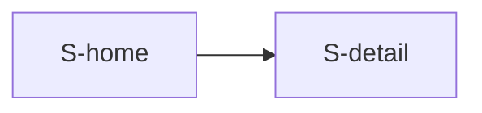

# Design

## UX principles
- 

## Screens & navigation
| ID       | Screen | Purpose | Wireframe | Requirements |
| -------- | ------ | ------- | --------- | ------------ |
| S-home   |        |         | `wireframes/S-home.md` | FR-001 |

## Visual design
- **Typography:** 
- **Colour tokens:** 
- **Spacing / layout grid:** 
- **Component library:** 

## API contracts
<!-- Endpoints or interfaces between components. One block per endpoint. -->
### `GET /example`
- **Serves:** FR-001
- **Request:** 
- **Response 200:** 
- **Errors:** 

## Content & copy
<!-- Tone, key labels, empty and error states. -->
